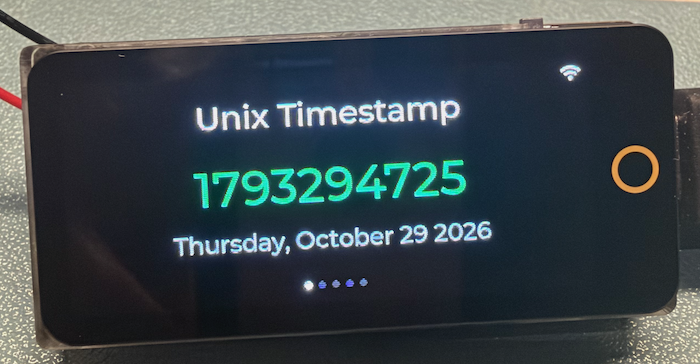
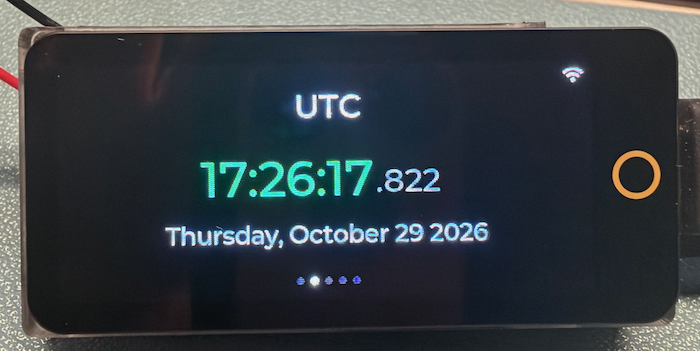
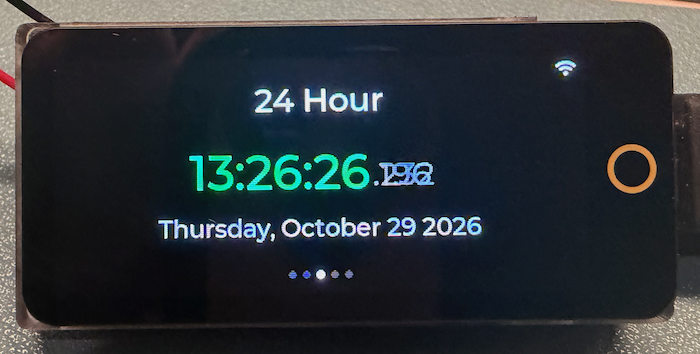
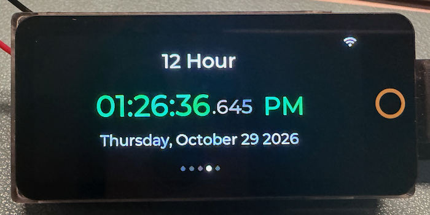

# Unix Timestamp Clock

A clean, swipeable clock for the **LILYGO T-Display-S3 AMOLED (Touch)** that displays the current Unix timestamp, UTC, 24-hour time, 12-hour time, and network status — with BLE-based WiFi provisioning and NTP time sync.

&color=red)







## Features

- **5 swipeable views** with circular navigation (swipe past the last page to loop back to the first)
- **Unix Timestamp** — raw seconds since epoch
- **UTC clock** — `HH:MM:SS.mmm` coordinated universal time with full date
- **24-hour clock** — `HH:MM:SS.mmm` with full date
- **12-hour clock** — `HH:MM:SS.mmm AM/PM` with full date
- **Live milliseconds** — smooth `.mmm` counter on the UTC, 24h and 12h views (~30 fps)
- **Network Info** — SSID, IP address, and RSSI signal strength
- **BLE WiFi provisioning** — configure WiFi credentials wirelessly via nRF Connect (PIN-protected)
- **NTP time sync** — syncs via `pool.ntp.org`, `time.nist.gov`, `time.google.com`, re-syncing every 15 minutes
- **WiFi status overlay** — white/amber/grey icon in the top-right corner
- **Page dot indicators** — 5 dots at the bottom, active dot shown in white
- **Brightness cycling** — tap the screen to cycle 4 brightness levels (64 → 128 → 192 → 255)
- **Credentials persist** across reboots via ESP32 NVS (Non-Volatile Storage)

## Hardware

| Component | Detail |
|---|---|
| Board | LILYGO T-Display-S3 AMOLED |
| Display | 1.91" AMOLED, 240×536, RM67162 QSPI |
| MCU | ESP32-S3 |
| Touch | CST816T |
| RAM | OPI PSRAM |

## Getting Started

### 1. Prerequisites

- [PlatformIO](https://platformio.org/) (VS Code extension or CLI)
- PlatformIO Core **≥ 6.1.19**

### 2. Clone and configure credentials

```bash
git clone <your-repo-url>
cd unix-timestamp-clock
cp include/secrets.h.example include/secrets.h
```

Edit `include/secrets.h` with your WiFi credentials, BLE PIN, and timezone:

```cpp
#define WIFI_SSID     "your_network_name"
#define WIFI_PASSWORD "your_password"
#define BLE_PIN       "12345"           // PIN required before BLE provisioning
#define TIMEZONE_STR  "EST5EDT,M3.2.0,M11.1.0"  // POSIX timezone string
```

> `secrets.h` is listed in `.gitignore` and will never be committed.

### 3. Build and flash

```bash
pio run --target upload
```

Or use the PlatformIO sidebar in VS Code: **Build → Upload**.

## BLE WiFi Provisioning

After flashing, you can update WiFi credentials wirelessly using **nRF Connect** (iOS or Android):

1. Open nRF Connect → scan → connect to **ClockConfig**
2. Find the service `4FAFC201-...`
3. Write to the characteristics **in order**:

| Step | Characteristic UUID | Value |
|---|---|---|
| 1 | `AA000001-...` **PIN** | Your PIN (e.g. `12345`) |
| 2 | `AA000002-...` **SSID** | Network name |
| 3 | `AA000003-...` **Password** | Network password (empty for open) |
| 4 | `AA000004-...` **Apply** | `1` |

The device reconnects immediately. Credentials are saved to NVS and survive reboots.

> The PIN must be written first. Any write to SSID/Password/Apply without a valid PIN is silently rejected.
> BLE re-advertises automatically after each disconnect — no reboot needed.

## Timezone Reference

Set `TIMEZONE_STR` in `secrets.h` using POSIX format:

| Region | Value |
|---|---|
| US Eastern | `EST5EDT,M3.2.0,M11.1.0` |
| US Central | `CST6CDT,M3.2.0,M11.1.0` |
| US Mountain | `MST7MDT,M3.2.0,M11.1.0` |
| US Pacific | `PST8PDT,M3.2.0,M11.1.0` |
| Central Europe | `CET-1CEST,M3.5.0,M10.5.0/3` |
| Japan | `JST-9` |
| UTC | `UTC0` |

## Architecture Overview

### Project Structure

```
unix-timestamp-clock/
├── include/
│   ├── config.h          # BLE UUIDs, brightness constants
│   ├── display.h         # build_ui() declaration, extern amoled
│   ├── wifi_manager.h    # wifi_ssid/pass externs, 3 public functions
│   ├── ble_provision.h   # ble_init() declaration
│   └── secrets.h         # credentials — gitignored, never committed
├── src/
│   ├── main.cpp          # setup() + loop()
│   ├── display.cpp       # All LVGL UI, timers, event callbacks
│   ├── wifi_manager.cpp  # NVS credential load, WiFi init, reconnect
│   └── ble_provision.cpp # BLE GATT server, PIN auth, credential apply
├── boards/
│   └── lilygo-t-amoled.json  # Custom board definition
└── platformio.ini
```

### Code Execution Flow

```
setup()
  │
  ├─ amoled.begin()              // Init display hardware
  ├─ setBrightness(192)          // Start at level 3/4
  ├─ beginLvglHelperDMA()        // Init LVGL with internal DMA buffers
  ├─ build_ui()                  // Create tileview, labels, overlay, timers
  │    ├─ on_clock_tick (33ms)   // ms labels every tick; time/date once per second
  │    └─ on_wifi_status_tick (2s) // Updates WiFi icon + network view
  ├─ load_wifi_credentials()     // Read from NVS (seed from secrets.h if first boot)
  ├─ ble_init()                  // Start BLE GATT server, begin advertising
  └─ wifi_init()                 // Connect to WiFi, trigger NTP on IP acquired (15 min re-sync)

loop()
  ├─ lv_task_handler()           // Drive LVGL rendering + timer callbacks
  └─ wifi_reconnect_check()      // Every 30s: reconnect if disconnected
```

### Visual Flow Diagram

```
┌─────────────────────────────────────────────────────────────┐
│                         BOOT                                │
└────────────────────────────┬────────────────────────────────┘
                             │
              ┌──────────────▼──────────────┐
              │   Display Init (AMOLED DMA)  │
              └──────────────┬──────────────┘
                             │
              ┌──────────────▼──────────────┐
              │    LVGL UI Build             │
              │  5 tiles + phantom tile 5    │
              │  Overlay: WiFi icon + dots   │
              │  Timers: clock(33ms)         │
              │          wifi_status(2s)     │
              └──────────────┬──────────────┘
                             │
         ┌───────────────────┼───────────────────┐
         │                   │                   │
┌────────▼────────┐ ┌────────▼────────┐ ┌────────▼────────┐
│  NVS Load       │ │   BLE Init      │ │   WiFi Init     │
│  credentials    │ │   "ClockConfig" │ │   STA mode      │
│  (seed on 1st   │ │   GATT server   │ │   begin()       │
│   boot only)    │ │   advertising   │ │                 │
└─────────────────┘ └────────┬────────┘ └────────┬────────┘
                             │                   │
                    ┌────────▼────────┐  ┌───────▼────────┐
                    │  nRF Connect    │  │  IP acquired   │
                    │  PIN → SSID     │  │  configTzTime  │
                    │  → Pass → Apply │  │  NTP sync      │
                    │  → NVS write    │  └───────┬────────┘
                    │  → WiFi reconn. │          │
                    └─────────────────┘  ┌───────▼────────┐
                                         │ gettimeofday() │
                                         │     valid      │
                                         │  Clocks update │
                                         └────────────────┘

─────────────────── MAIN LOOP (every 5ms) ───────────────────

  lv_task_handler()
       │
       ├── on_clock_tick (33ms)
       │       ├── every tick:      .mmm labels (UTC, 24h, 12h)
       │       └── once per second: Unix timestamp, HH:MM:SS labels,
       │                            dates, 12h AM/PM label
       │
       └── on_wifi_status_tick (2s)
               ├── WiFi icon color (white / amber / grey)
               └── Network view: SSID, IP, RSSI

  wifi_reconnect_check (every 30s)
       └── if disconnected → disconnect() + begin()

─────────────────── USER INTERACTION ────────────────────────

  Swipe left/right  →  Navigate between views (circular)
  Tap screen        →  Cycle brightness (64→128→192→255→64)
```

## Key Technical Notes

| Topic | Detail |
|---|---|
| LVGL circular navigation | Phantom tile at col 5; `VALUE_CHANGED` defers snap to tile 0 via a 1ms one-shot timer — calling directly corrupts scroll state |
| DMA buffers | `beginLvglHelperDMA` used instead of `beginLvglHelper` to avoid PSRAM init dependency on cold boot |
| BLE before WiFi | BLE must be initialized first — both share the same radio and the coexistence layer expects this order |
| NVS seeding | `secrets.h` values seed NVS only on first boot (`isKey("ssid")` check). BLE-provisioned values persist across reboots |
| Milliseconds display | `.mmm` is a separate, smaller label next to `HH:MM:SS`, so fast-changing digits never shift the main time. On the 12h view, AM/PM is its own static label at a fixed offset (space reserved for the widest `.000`), so it never flickers or moves |
| Update rate | Clock timer runs every 33 ms but only the ms labels change every tick; the main time, dates and Unix timestamp are rebuilt only when the second changes. Time is read with `gettimeofday()` so seconds roll over exactly at `.000` |
| NTP interval | `sntp_set_sync_interval()` reduces re-sync from the 3 h SDK default to 15 min, limiting crystal drift between syncs |
| AMOLED power | True black (`#000000`) background saves power on OLED — unlit pixels draw no current |

## Time Accuracy

- NTP over WiFi is typically accurate to **±10–50 ms** (network delay; the ESP32 uses simple one-shot SNTP).
- Between the 15-minute re-syncs the ESP32 crystal drifts by roughly **10–20 ms**.
- The millisecond digits count smoothly but are not millisecond-accurate — treat the last digit as decorative.
- If WiFi drops, the clock keeps running on the crystal (drifting ~1–2 s/day) until it reconnects. With no WiFi at boot it stays on "Syncing..." (no battery-backed RTC).
1
## Display Colors

| Element | Color |
|---|---|
| Background | `#000000` black (unlit AMOLED pixels) |
| Clock digits, AM/PM, network SSID | `#00C853` green |
| View titles, active page dot, connected WiFi icon | `#FFFFFF` white |
| Date text | `#CCCCCC` off-white |
| Milliseconds, network details | `#777777` grey |
| WiFi error icon | `#FF6B35` amber |
| Inactive page dots, connecting WiFi icon | `#333333` dark grey |

Colors are defined at the top of `src/display.cpp`.

## platformio.ini Notes

```ini
platform = espressif32@6.5.0          ; pinned — Core 6.1.18 incompatible
board_build.arduino.memory_type = qio_opi  ; required for OPI PSRAM hardware init
build_flags = -DARDUINO_USB_CDC_ON_BOOT=1 -DBOARD_HAS_PSRAM
lib_deps = xinyuan-lilygo/LilyGo-AMOLED-Series@^1.2.3
```

## License

This project is open source. See the [LICENSE](LICENSE) file for details.
